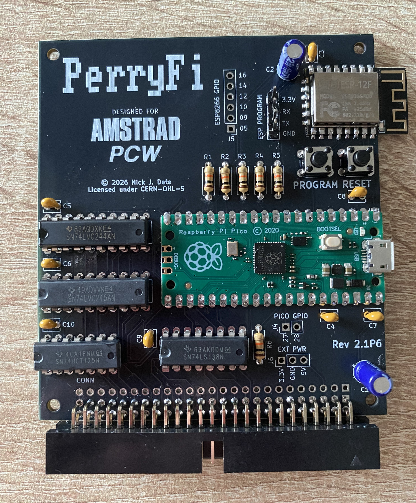

# PerryFi 2

1. [Introduction](#introduction)
2. [Licences](#licences)
3. [Obtaining the PCB](#obtaining-the-pcb)
4. [Bill of Materials (BOM)](#bom)
5. [Flashing the Firmware](#flashing-the-firmware)
6. [Included Software](#included-software)
7. [Special Thanks](#special-thanks)
8. [Project PerryFi](#project-perryfi)

 

## Introduction

PerryFi 2 is a wifi expansion card for the Amstrad PCW series of computers.

It uses a Raspberry Pi Pico microcontroller board to implement a Z80 DART and a 8523 timer at high speed, and an ESP-12F module to implement AT-style modem functionality along with SLIP and PPP networking.

The PerryFi 2 is designed to either plug into the [PCW Backplane](https://github.com/SanPollo/PCWBackplane), or directly into the PCW's expansion port.

If you would like a pre-built version of the board, you can order one from the [PCBWay project](https://www.pcbway.com/project/shareproject/PerryFi_2_Amstrad_PCW_Wifi_Expansion_6e6dad4e.html).

[Index](#perryfi-2)

 

## Licences

The PerryFi PCB, and its source files, are licensed under the [CERN Open Hardware Licence Version 2: CERN-OHL-S](https://opensource.org/license/cern-ohl-s).

CP/M is licensed under the [CP/M Licence 2022](http://www.cpm.z80.de/license.html).

BAUDEXT.FID is licensed under the [MIT Licence](https://mit-license.org/).

SETSIO.COM and QTERM are believed to be in the public domain, as are the other programs featured on the [disc images](software/) in this repo.

[Index](#perryfi-2)

 

## Obtaining the PCB

As mentioned above, you can either order this directly from its [project page on PCBWay](https://www.pcbway.com/project/shareproject/PerryFi_2_Amstrad_PCW_Wifi_Expansion_6e6dad4e.html), or from [downloading the gerbers](gerbers/PerryFiV2.1R.zip), and uploading them to your favourite PCB manufacturer. I highly recommend JLCPCB.

[Index](#perryfi-2)

 

## BOM

### Passives

| Ref | Qty | Part | Source |
| --- | --- | ---- | ------ |
| C1 | 1 | 22uF 16V Electrolytical Capacitor | [Mouser](https://www.mouser.co.uk/ProductDetail/Wurth-Elektronik/860010372002?qs=0KOYDY2FL2%252B9WwJ0SbWRgQ%3D%3D) |
| C2 | 1 | 10uF 16V Electronic Capacitor | [Mouser](https://www.mouser.co.uk/en/ProductDetail/Wurth-Elektronik/860010372001?qs=0KOYDY2FL29NKHIi2kspeA%3D%3D) |
| C3 - C10 | 8 | 0.1uF / 100 nF (104) Ceramic Capacitor | [Mouser](https://www.mouser.co.uk/ProductDetail/Vishay-BC-Components/K104K15X7RF5UL2?qs=rLgk8CAOBHbCqsnkGO2HJA%3D%3D) |
| J3 | 1 | 1x4-pin Header Male | [Mouser](https://www.mouser.co.uk/en/ProductDetail/TE-Connectivity/87224-4?qs=ZDXmSm13593XigDDyAAvFA%3D%3D) |
| R1 - R6 | 6 | 10K Resistor | [Mouser](https://www.mouser.co.uk/en/ProductDetail/Vishay-BC-Components/SFR25H0001002JR500?qs=6iGubpYEgGl%2FWs77gjt1Ig%3D%3D) |

### MCU Boards

| Ref | Qty | Part | Source |
| --- | --- | ---- | ------ |
| A1 | 1 | Raspberry Pi Pico Clone | [AliExpress](https://www.aliexpress.com/w/wholesale-raspberry-pi-pico.html) |
| U1 | 1 | ESP12-F Module | [AliExpress](https://www.aliexpress.com/w/wholesale-esp12%2525252df.html) |

### Logic ICs

| Ref | Qty | Part | Source |
| --- | --- | ---- | ------ |
| U2 | 1 | 74HCT125 | [Mouser](https://www.mouser.co.uk/en/ProductDetail/Texas-Instruments/SN74HCT125N?qs=NLW4NjXEBS5VnYqdavwjrw%3D%3D) |
| U3 | 1 | 74LVC244 | [Mouser](https://www.mouser.co.uk/en/ProductDetail/Texas-Instruments/SN74LVC244AN?qs=5WY7Uqh921zt6%252BldompdKA%3D%3D) |
| U4 | 1 | 74LVC245 | [Mouser](https://www.mouser.co.uk/en/ProductDetail/Texas-Instruments/SN74LVC245AN?qs=N6WZOzgtpqVHY3EQAIUFKw%3D%3D) |
| U5 | 1 | 74LS138 | [Mouser](https://www.mouser.co.uk/ProductDetail/Texas-Instruments/SN74LS138N?qs=j01uVdFEFjG9iU5k7BL8mw%3D%3D) |

### Connector

The box header is for use with the [PCW Backplane](https://github.com/SanPollo/PCWBackplane), whereas the female edge connector allows you to plug the PerryFi 2 directly into your PCW's expansion port.

| Ref | Qty | Part | Source |
| --- | --- | ---- | ------ |
| CONN | 1 | 2x25-pin 90-deg Keyed Male Box Header | [AliExpress](https://www.aliexpress.com/w/wholesale-50-pin-2.54mm-male-connector-right-angle.html) |
| CONN | 1 | 50-pin Female Edge Connector | [AliExpress](https://www.aliexpress.com/w/wholesale-50-pin-edge-connector.html) |

Note that the box header is soldered to the front of the board, to the bottom two rows, but the edge connector is soldered to the back of the board.

When assembled with an edge connector, the PerryFi 2 connects to the expansion board on the back of the PCW with its front facing you, and the ESP12-F's antenna facing towards the edge of the PCW, **not** towards the middle.

### Sockets

These are entirely optional. Note that you will save a lot of money shopping around on AliExpress versus buying sockets and pin headers from Mouser.

| Ref | Qty | Part | Source |
| --- | --- | ---- | ------ |
| A1 | 2 | 20-pin Pin Header Male 20-pin Pin Header Female | [Mouser](https://www.mouser.co.uk/en/ProductDetail/TE-Connectivity/2-826629-0?qs=FazuUmncXom55roGwM1n6g%3D%3D) [Mouser](https://www.mouser.co.uk/en/ProductDetail/TE-Connectivity/1-535541-8?qs=4SZgfGyd%252B6cN18BaeVsGZA%3D%3D) |
| U1 | 2  1 | 1.27mm 8-pin Pin Header Male and Female 1.27mm 6-pin Pin Header Male and Female| [AliExpress](https://www.aliexpress.com/w/wholesale-pin-header-1.27mm.html?spm=a2g0o.productlist.search.0) |
| U2 | 1 | 14-pin IC DIP Socket | [Mouser](https://www.mouser.co.uk/ProductDetail/TE-Connectivity/1-2199298-3?qs=fK8dlpkaUMtBOtVI99wRlQ%3D%3D) |
| U3 - U4 | 2 | 20-pin DIP Socket | [Mouser](https://www.mouser.co.uk/en/ProductDetail/TE-Connectivity/1-2199298-6?qs=fK8dlpkaUMvuMXpJTs4GlA%3D%3D) |
| U5 | 1 | 16-pin DIP Socket | [Mouser](https://www.mouser.co.uk/ProductDetail/TE-Connectivity/1-2199298-4?qs=fK8dlpkaUMvpL10rY9Abiw%3D%3D) |

[Index](#perryfi-2)

 

## Flashing the Firmware

There are two different firmwares to flash. These can be found in their respective repositories along with instructions for flashing them:

[PicoDART](https://github.com/SanPollo/PicoDART) - Raspberry Pi Pico Firmware
[PerryZi](https://github.com/SanPollo/PerryZi) - ESP12-F Firmware

[Index](#perryfi-2)

 

## Included Software

There are two boot images included; one for the [Amstrad PCW 8256 family](software/perryfi_2.1_boot_8256.dsk) (dot matrix printers), and one for the [9512 family](software/perryfi_2.1_boot_9512.dsk) (daisy wheel printers). They both 720KB images, and are designed to be used on a [modded Gotek](https://github.com/SanPollo/PCWGotekMod).

Boot the relevant image on your PCW, and run the **QTERMPF.COM** terminal emulator. You will then be able enter **AT+CONFIG** to configure your wifi settings. For a complete list of commands, see the [Command Reference](https://github.com/SanPollo/PerryZi/wiki/Command-Reference) on the PerryZi wiki.

There is also a [third disk image](software/comms.dsk), which contains additional communications software for you to try.

[Index](#perryfi-2)

 

## Special Thanks

It's been a hectic four months working on this project, and I want to thank the following people:

* [John Elliott](https://seasip.info/), for writing the fantastic [Joyce](https://www.seasip.info/Unix/Joyce/) emulator, and for his brilliant [PCW Hardware](https://www.seasip.info/Unix/Joyce/hardware.pdf) documentation. Without these, the project may not have been possible.

* Lee Taylor, for his technical help and support. It's always great to have someone more experienced to advise you.

* [Salvatore Bognanni](https://github.com/salvogendut/), for his endless enthusiasm, driving me on, and his keenness to help test.

* [Stefan P](https://github.com/svpantazi/) for helping me with the ESP12-F KiCad footprint, and for his advice about exposing to GPIO pins for both MCUs. Without this, debugging the board would have been far more cumbersome.

[Index](#perryfi-2)

 

## Project PerryFi

Project PerryFi consists of several separate components which make the PerryFi 2 possible:

* [PerryFi 2](https://github.com/SanPollo/PerryFi2) - Hardware
* [PerryDART](https://github.com/SanPollo/PicoDART) - Pico Firmware
* [PerryZi](https://github.com/SanPollo/PicoZi) - ESP8266 Firmware

[Index](#perryfi-2)